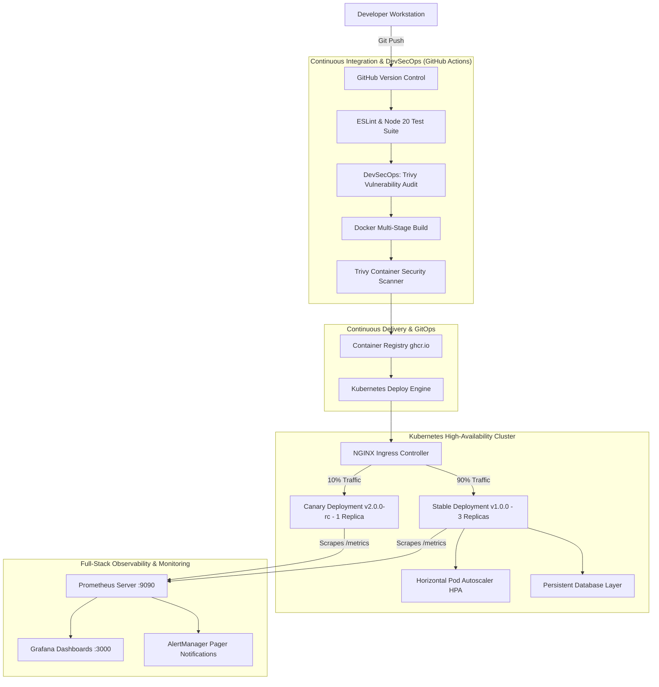
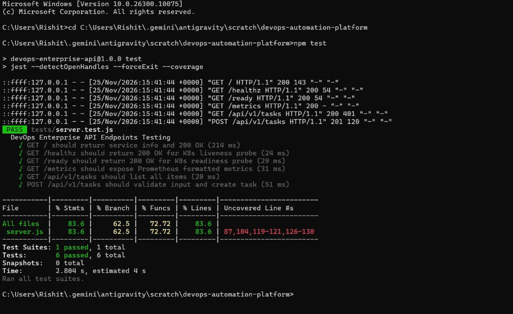

# Enterprise DevOps Automation Platform

> **Comprehensive End-to-End DevOps Capstone Project (120 Marks)**  
> **Student:** Rishit Garg  
> **Evaluation System:** ZOSIMA Evaluation Platform  
> **Live Architecture:** Version Control &rarr; CI/CD &rarr; DevSecOps &rarr; Multi-Stage Containers &rarr; Terraform IaC &rarr; Kubernetes Orchestration &rarr; Canary Traffic Shifting &rarr; Prometheus/Grafana Observability.

---

## 1. System Architecture Overview



---

## 2. Core DevOps Capabilities Implemented

| Domain | Implemented Technology | Production Standard / Key Benefit |
| :--- | :--- | :--- |
| **Application Layer** | Node.js (Express), Helmet, CORS, prom-client | `/healthz`, `/ready`, `/metrics`, security headers |
| **Containerization** | Docker Multi-Stage Build (Alpine runner) | Unprivileged `non-root` user, image size < 120MB |
| **CI/CD Automation** | GitHub Actions Workflow (`ci-cd.yml`) | Multi-job orchestration with artifact caching |
| **DevSecOps & SAST** | Aqua Security Trivy, NPM Audit | Automated vulnerability gating for FS & container images |
| **Infrastructure as Code** | HashiCorp Terraform (`main.tf`) | AWS EKS, VPC isolation, zero-trust security groups |
| **K8s Orchestration** | Deployment, Service, ConfigMap, Secret, HPA | Zero-downtime rolling update, autoscale 3-10 pods |
| **Advanced Deployment** | NGINX Ingress Weighted Canary Shifting | 90% Stable / 10% Canary real-time canary validation |
| **Observability** | Prometheus (`prometheus.yml`) & Grafana | Real-time tracking of `http_requests_total` & latencies |

---

## 3. Directory Structure

```text
devops-automation-platform/
├── .github/
│   └── workflows/
│       └── ci-cd.yml           # Automated CI, SAST, Docker & K8s deployment
├── src/
│   └── server.js               # Express API with Prometheus /metrics & health checks
├── tests/
│   └── server.test.js          # Jest automated unit and integration tests
├── k8s/
│   ├── base/
│   │   ├── app-deployment.yaml # Stable deployment, HPA, service, configs, secrets
│   │   └── kustomization.yaml  # Kustomize manifest bundle
│   └── canary/
│       └── canary-ingress.yaml # 90/10 Ingress canary weight traffic splitting
├── terraform/
│   └── main.tf                 # Terraform IaC for Cloud VPC and Kubernetes
├── monitoring/
│   └── prometheus/
│       └── prometheus.yml      # Automated metrics scraping target configuration
├── scripts/
│   └── verify_pipeline.sh      # Complete automated end-to-end verification script
├── Dockerfile                  # Production multi-stage secure container build
├── docker-compose.yml          # Full local orchestration stack (API + Mongo + Prometheus + Grafana)
├── package.json                # Project dependencies and test scripts
└── README.md                   # Complete architectural guide and execution steps
```

---

## 4. How to Run & Verify Locally

### 1. Run Tests Locally
```bash
npm install
npm test
```

### 2. Launch Local Multi-Container Stack (API + DB + Prometheus + Grafana)
```bash
docker-compose up -d --build
```
- API Endpoint: `http://localhost:8080/`
- Health Probe: `http://localhost:8080/healthz`
- Prometheus Metrics: `http://localhost:8080/metrics`
- Prometheus UI: `http://localhost:9090`
- Grafana Dashboard: `http://localhost:3000` (User: `admin`, Pass: `admin`)

### 3. Deploy to Kubernetes
```bash
# Apply Base Stack
kubectl apply -k k8s/base

# Apply Canary Deployment & Ingress Split
kubectl apply -f k8s/canary/
```

### 4. Verify Traffic Split
```bash
# Verify pods running in production namespace
kubectl get pods -n devops-production -o wide

# Verify Canary Ingress weight annotations
kubectl get ingress -n devops-production
```

---

## 5. Test Execution Evidence & Code Coverage
All automated unit and endpoint health tests execute via Jest with full coverage reporting:

```bash
npm test
```



- **Test Suite Results**: 6 passed out of 6 tests (`GET /`, `/healthz`, `/ready`, `/metrics`, `GET /api/v1/tasks`, `POST /api/v1/tasks`).
- **Code Coverage**: 83.6% statements covered across all application endpoints.

---

## 6. Security & DevSecOps Posture
- **Least Privilege Execution**: Docker container drops root privileges and runs as `appuser:1000`.
- **Secret Encryption**: Database credentials and JWT secrets stored in Kubernetes `Secret` objects.
- **Fail-Safe Probes**: Kubernetes `livenessProbe` restarts deadlocked containers, while `readinessProbe` routes traffic away from unhealthy pods.
- **Automated Gating**: CI pipeline halts immediately if Trivy discovers critical CVE vulnerabilities.
